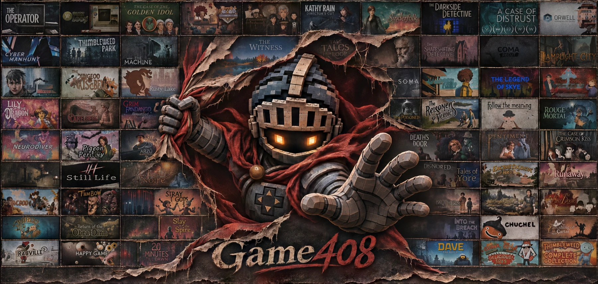
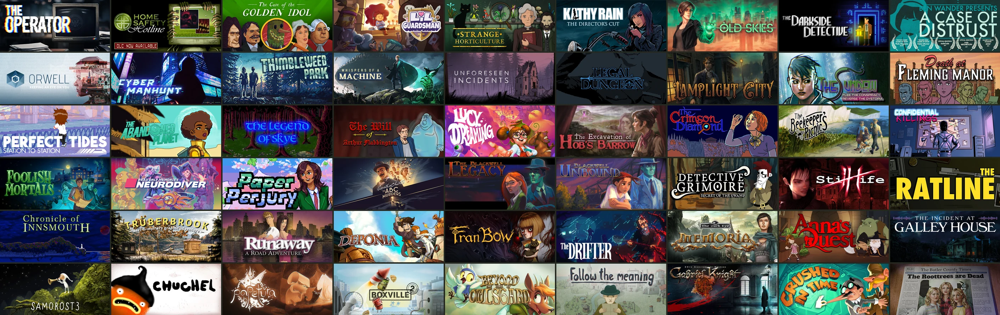
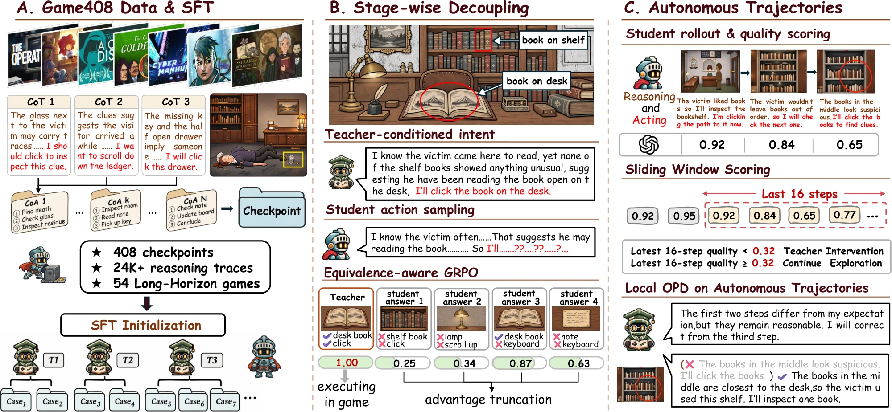
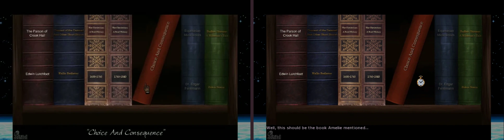

# Game408

**Deep Reasoning from Clues to Actions in Long-Horizon Narrative Game Worlds**

[Project page](https://jing-2237.github.io/Game408/) · [Evaluation protocol](#evaluation-protocol) · [Task browser](https://jing-2237.github.io/Game408/#arena) · [Code layout](#repository-layout) · [简体中文](README.zh-CN.md)



Can an agent use a clue found several scenes ago to choose its next move? Game408 studies this question in 2D narrative and puzzle games. Each run starts from a story checkpoint with a defined goal. The evaluation tracks whether the agent reaches that goal and whether its individual decisions use the evidence it had at the time.

## Dataset

| Games | Story checkpoints | Human gameplay | Reasoning and action annotations |
| ---: | ---: | ---: | ---: |
| 54 | 408 | 260+ hours | 24,000+ |

Experienced volunteers mapped main and side storylines to place checkpoints at meaningful stage boundaries. Novice players then checked the clarity of the objectives and starting information. The game-level split uses **42 titles for training** and **12 held-out titles with 83 checkpoints for evaluation** in **Game408-Val**.

- **Game408-CoT** documents individual semantic actions. Each record connects a pre-action observation with earlier clues, the player's intent, the operation, and its recorded feedback.
- **Game408-CoA** organizes sequences of actions by story stage. It includes successful play, genuine mistakes, and recovery steps such as retrying, switching tools, or repositioning.
- **Reasoning horizons D0–D3** describe how far back the necessary evidence comes from. D0 uses the current screen. D1 adds recent actions or clues from the same scene. D2 combines multiple clues or prerequisites within a story segment. D3 draws on evidence, branch states, or goals across scenes or stages.

[Browse the 54-game catalog and Steam cover sources](GAME_CATALOG.md)



## GameHunter

GameHunter is the vision-language agent introduced in the paper. The student is fine-tuned from **Qwen3.5-9B**, and the teacher models are fine-tuned from **Qwen3.5-4B**. Training proceeds in three stages.

1. **Supervised fine-tuning (SFT)** learns to generate reasoning and semantic actions from human-verified Game408 annotations.
2. **Action execution training** supplies the teacher's intent and compares student actions under that fixed intent. Correctness-constrained GRPO encourages valid implementations of the intended operation.
3. **Local on-policy distillation (OPD)** lets the student act in the game. When the quality of recent decisions falls below the sliding-window threshold, a stage-specific teacher jointly supervises reasoning and actions on the student's own trajectory.



## Evaluation protocol

Agents start from a Game408-Val checkpoint and interact with the game to reach the corresponding objectives. Game-level measures and decision-level scores answer different questions.

| Game-level metric | How it is measured |
| --- | --- |
| **Score** | Compute the completion rate for each game's checkpoint-stage and achievement goals, then average the rates equally across games. |
| **Efficiency** | Effective actions divided by all actions. Necessary navigation, evidence collection, and tests supported by available evidence count as effective. |
| **Time** | Mean latency from model input to action completion. |

For each decision, an LLM judge examines the frame, task state, available action history, and retrieved memories **as they were before the action**. It grades the model's reasoning and semantic tool call on the seven criteria below. Each applicable, assessable criterion receives an integer from **0 to 5** with supporting evidence.

| Group | Criterion | What earns full credit |
| --- | --- | --- |
| Action | Action Selection | The operation fits the subgoal and known constraints and can advance the task or test a hypothesis. |
| Action | Target Grounding | The call identifies the right object or equivalent control, including both endpoints of a drag when needed. |
| Reasoning | Logical Validity | The key inference follows from available facts and justified assumptions. |
| Reasoning | Trajectory Consistency | The reasoning matches the current branch, prior outcomes, and remaining prerequisites. |
| Reasoning | Clue Use | The reasoning explains how the available clues support the choice or rule out alternatives. |
| Reasoning | Memory Recall | The reasoning recalls an earlier relevant fact accurately and connects it to the decision. |
| Reasoning | Action Judgment | The reasoning identifies the operation's prerequisites and treats unverified effects as expectations. |

When all seven criteria can be scored, the normalized step score is the raw total divided by **35**. For the overall report, each criterion is averaged over the applicable and assessable steps and converted to a percentage. **Action** averages its two criterion percentages, and **Reasoning** averages its five.

**Worked example from Lamplight City.** Amélie remembers a book the color of her stew spices. After checking the reddish and orange spices, the player inspects the matching copy of *Choice and Consequence*. The earlier testimony and kitchen observation support the action. Inspecting the correct volume grounds the choice, and Miles's subsequent remark provides feedback.



[Before the action, at left](docs/assets/cases/lamplight-414.webp) · [Recorded outcome, at right](docs/assets/cases/lamplight-414-after.webp)

## Leaderboard and tasks

The [leaderboard](https://jing-2237.github.io/Game408/#leaderboard) shows the closed-source comparisons reported for Game408-Val.

In the task browser, inspect a pre-action frame and earlier clues, then compare your choice with the reference action, its reasoning, and the recorded outcome. The [playtest review](PLAYTEST.md) lists the records and frame alignments.

## Repository layout

The scoring example uses synthetic checkpoint outcomes to compute completion, action efficiency, and mean latency.

```shell
python -m evaluation.run configs/scoring.example.json
```

[`evaluation/`](evaluation/) · [`training/`](training/) · [`models/`](models/) · [`data/`](data/) · [`configs/`](configs/) · [`docs/`](docs/)

To preview the website locally, run `python -m http.server 8000 --directory docs` from the repository root and open [localhost:8000](http://localhost:8000).

The website code is released under the [MIT License](LICENSE). See the [figure, recording, and Steam artwork credits](docs/assets/NOTICE.md).
