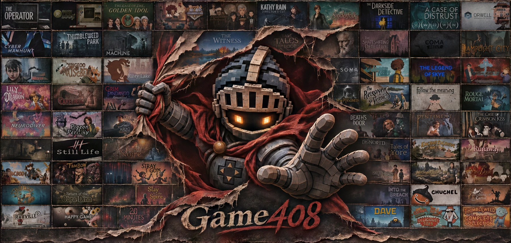
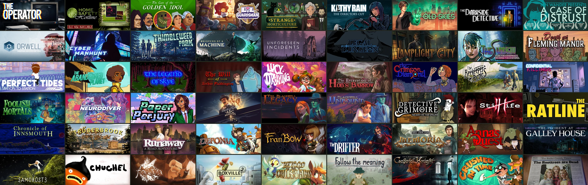
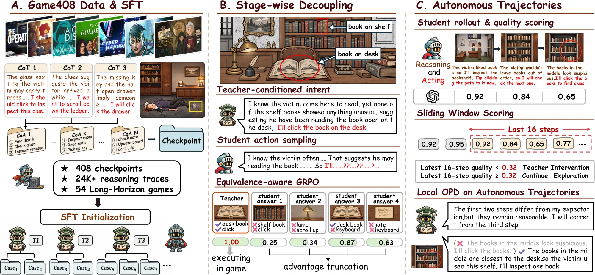
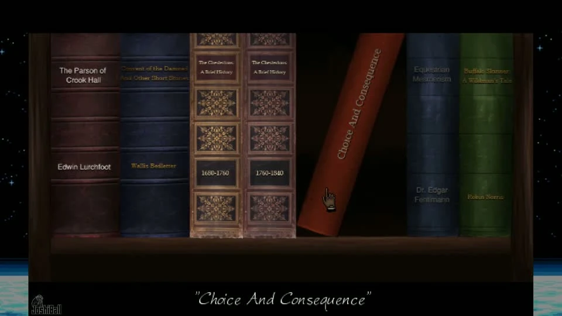
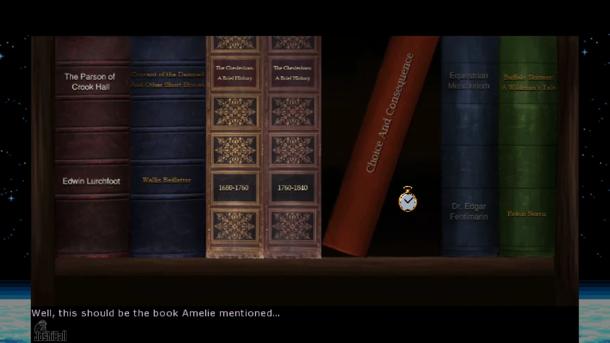

# Game408

**长程叙事游戏世界中从线索到动作的深度推理**

[项目主页](https://jing-2237.github.io/Game408/) · [评测规则](#评测规则) · [任务浏览](https://jing-2237.github.io/Game408/#arena) · [代码目录](#代码目录) · [English](README.md)

智能体能否想起几个场景前见过的线索，并据此决定下一步？Game408 在二维叙事和解谜游戏中评测这个问题。每轮从带有明确目标的剧情存档点开始，既记录目标是否完成，也检查每一步动作能否由当时掌握的证据支持。

## 数据集

| 游戏 | 剧情存档点 | 真实玩家录屏 | 人工推理与动作标注 |
| ---: | ---: | ---: | ---: |
| 54 款 | 408 个 | 260+ 小时 | 24,000+ 条 |

有经验的志愿者梳理主线和支线，在有明确阶段目标的位置划分存档点，再由新手玩家试玩并检查初始信息和目标是否清楚。数据按游戏划分，**42 款用于训练**，另外 **12 款和其中的 83 个存档点**构成独立评测集 **Game408-Val**。

- **Game408-CoT** 以一次语义动作为单位，记录动作前的观察、早先的相关线索、行动意图、实际操作和交互反馈。
- **Game408-CoA** 按剧情阶段组织动作序列，包含有效操作、真实失误和重试、换工具、重新定位等恢复动作。
- **D0–D3 推理跨度**描述当前决策所需的证据范围。D0 依靠当前画面，D1 还需要近期动作或同场景线索，D2 需要结合局部剧情内的多条线索或前置条件，D3 则涉及跨场景或跨阶段的证据、分支状态或目标。

[查看 54 款游戏名单与 Steam 封面来源](GAME_CATALOG.md)

## GameHunter 模型

GameHunter 是论文提出的视觉语言智能体。学生模型基于 **Qwen3.5-9B** 微调，教师模型基于 **Qwen3.5-4B** 微调，训练分为三个阶段。

1. **监督微调（SFT）**。用 Game408 中经人工核对的标注，训练模型生成推理和语义动作。
2. **动作执行训练**。给定教师提供的意图，对比学生在同一意图下生成的多种动作，使用受正确性约束的 GRPO 训练有效执行。
3. **局部在线策略蒸馏（OPD）**。学生在游戏中自主探索。滑动窗口检测到近期决策质量下降时，由对应游戏阶段的教师在学生实际走过的轨迹上联合监督推理和动作。

## 评测规则

智能体从 Game408-Val 指定存档点出发，通过与游戏交互完成对应目标。整体表现和每一步决策质量分别统计。

| 整体指标 | 计算方式 |
| --- | --- |
| **任务完成分（Score）** | 先计算每款游戏的存档阶段目标与成就目标完成率，再对各游戏等权平均。 |
| **动作效率（Efficiency）** | 有效动作数除以全部动作数。必要导航、取证和有证据支持的试探都算有效。 |
| **平均耗时（Time）** | 模型收到输入到动作执行完毕的平均耗时。 |

单步评审只依据**动作前可用的画面、任务状态、操作历史和召回记忆**，检查本步推理与语义工具调用。每项适用且可判定的指标由评审模型给出 **0 至 5 分**，并列出判分依据。

| 类别 | 评分项 | 满分条件 |
| --- | --- | --- |
| 动作 | 动作选择 | 操作符合当前子目标和已知约束，可推进任务或验证假设。 |
| 动作 | 目标定位 | 工具调用指向正确对象或等效控件，例如拖拽时源和目标都正确。 |
| 推理 | 逻辑有效性 | 关键结论由当前可用的事实和有依据的假设推出。 |
| 推理 | 轨迹一致性 | 推理符合当前分支、已发生的结果和剩余前置条件。 |
| 推理 | 线索利用 | 说明有关线索怎样支持选择或排除其他方案。 |
| 推理 | 记忆召回 | 准确召回有关历史事实，并说明它怎样影响当前决策。 |
| 推理 | 动作判断 | 说明操作前提，尚未验证的作用作为预期效果处理。 |

七项均适用且可判定时，单步总分为原始分之和除以 **35**。汇总报告先把每项在适用且可判定步骤中的平均分换算为百分制，再对动作组两项和推理组五项分别求平均。

**《灯火之城》的评测示例。** Amélie 记得那本书的颜色像炖菜香料。玩家在厨房核对出红橙色线索后，在书架上检查颜色对应的《Choice and Consequence》。早先证词与厨房观察支持动作选择，点中对应的书考察目标定位，迈尔斯随后关于这本书的对白提供了结果反馈。

| 动作前画面 | 录屏中的结果 |
| --- | --- |
|  |  |

## 排行榜、任务与发布

排行榜展示论文中的 Game408-Val 对比结果，可按整体、动作和推理指标排序。人类表现单列为参考。

任务浏览区收录了 14 款游戏的 30 个录屏决策。可以先看动作前画面和历史线索，再选择下一步，并对照实录动作、推理依据和结果。[试玩审校记录](PLAYTEST.md)列出了标注编号、结果帧来源和画面对齐的修正。

| 资源 | 状态 |
| --- | --- |
| 项目主页与交互试玩 | 已上线 |
| 评测、训练与数据处理 | 已提供占位接口和配置示例 |
| GameHunter 权重 | 待发布 |
| Game408 数据集及标注 | 待发布 |
| 公开结果提交 | 待开放 |

## 代码目录

| 路径 | 后续接入内容 |
| --- | --- |
| [`evaluation/`](evaluation/) | 评测入口、单存档运行、游戏环境适配、评分与汇总。 |
| [`training/`](training/) | 训练入口和数据读取接口。 |
| [`models/`](models/) | GameHunter 模型与智能体加载接口。 |
| [`data/`](data/) | 标注处理和存档清单准备。 |
| [`configs/`](configs/) | 路径留空的评测与训练配置样例。 |
| [`docs/`](docs/) | 主页、游戏素材与经审校的试玩片段。 |

Python 占位函数会抛出 `NotImplementedError`，可直接把函数体替换为正式实现。

在仓库根目录运行 `python -m http.server 8000 --directory docs`，即可打开[本地预览](http://localhost:8000)。

主页代码采用 [MIT 许可证](LICENSE)。论文插图、录屏截图和 Steam 封面的来源见[素材署名](docs/assets/NOTICE.md)。
